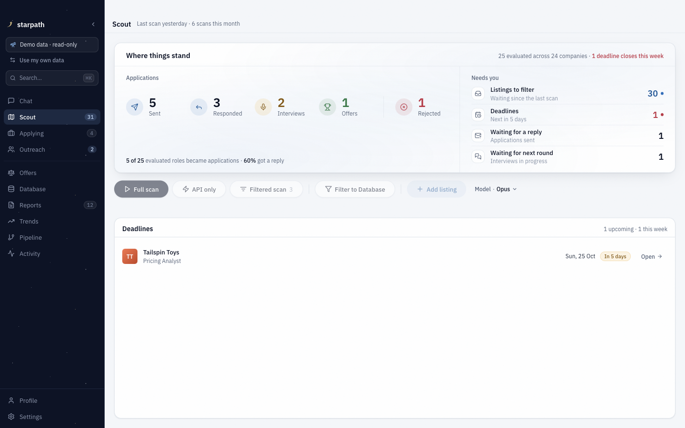
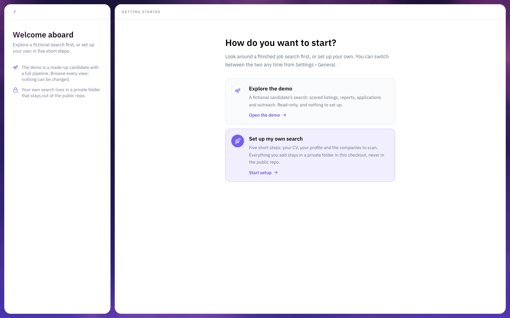
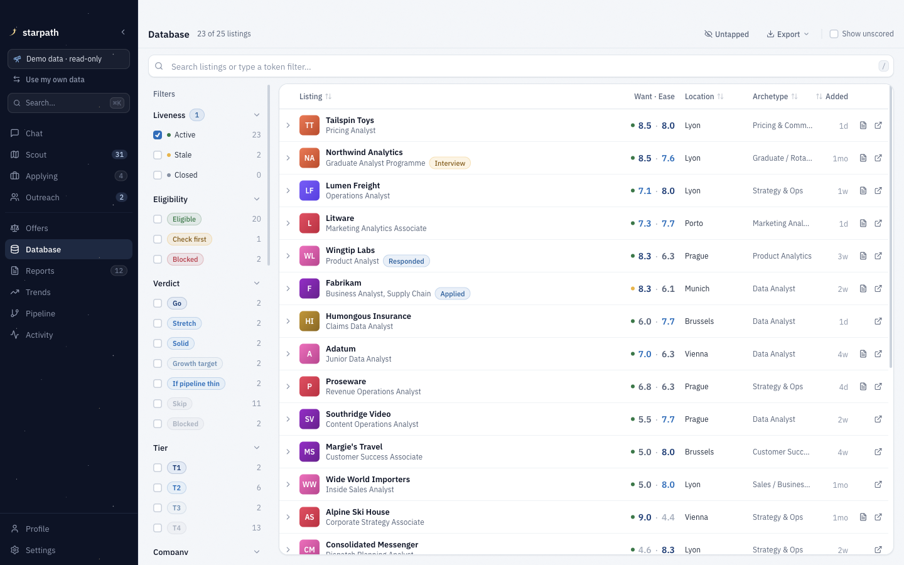
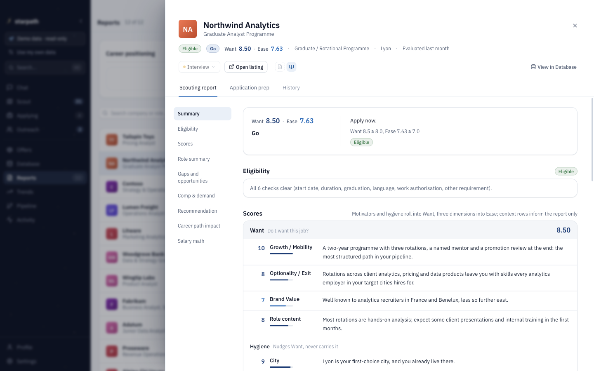
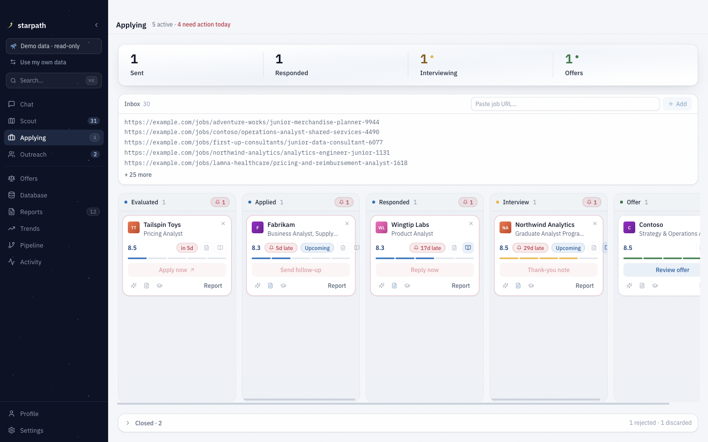

# starpath

A local-first job-search workspace. It scans company job boards, scores every listing against your own profile, writes an evaluation report you can audit, and tracks applications and outreach in a desktop app. The AI work runs through [Claude Code](https://claude.ai/download) on your own machine; your data stays in plain Markdown files on your disk.



Everything in these screenshots is the bundled demo: a fictional candidate, fictional companies, fictional reports.

## Try it in two minutes

You need macOS and Node 22 or newer (24 to run the test suites). Claude Code is only needed for the AI runs (scans, evaluations, tailoring); the demo works without it.

```bash
git clone https://github.com/Alemz85/starpath.git
cd starpath && npm install
cd frontend && npm install && npm run dev
```

The app opens on a choice: **Explore the demo** (read-only, nothing to set up) or **Set up my own search** (a five-step wizard: CV, profile, target roles, companies to scan).



## What it does

- **Scans the market.** Pulls postings straight from Greenhouse, Ashby, Lever, SmartRecruiters and Workday APIs for the companies you track, plus Indeed and Google Jobs through [JobSpy](https://github.com/speedyapply/JobSpy), deduplicated across sources and filtered by your title rules. Scanning costs no tokens.
- **Scores honestly.** Each listing first passes an eligibility gate (start date, duration, graduation window, language, work rights); a hard wall shows as *Blocked* with its reason instead of a misleading number. Then two 1–10 scores: **Want** (growth, optionality, brand, the work itself, with city, salary and work-life balance as hygiene) and **Ease** (skills match, experience bar, competition). The Want × Ease grid gives the verdict: Go, Stretch, Solid, Growth target, If pipeline thin, Skip. The arithmetic is a tested script, not the model's opinion; the model supplies JD-grounded judgments and the reasoning. Spec: [`docs/scoring-v2.md`](docs/scoring-v2.md).
- **Writes reports worth reading.** Depth follows the verdict: a Go gets role summary, gaps, comp, recommendation and career-path impact; a Skip gets the table and one line on why.
- **Tracks the pipeline.** Applications move across a board (Evaluated → Applied → Responded → Interview → Offer) with deadlines, follow-up cadence and outreach nudges.
- **Prepares you.** Tailored CVs (HTML → PDF), application answers, interview prep mapped to a STAR story bank, mock-interview questions, referral paths from your network.
- **Never applies for you.** It fills forms and drafts messages, then stops before Submit or Send.







## How it works

| Piece | What it is | Where |
|------|-----------|-------|
| Data layer | CV, profile, trackers, score history, reports: plain Markdown and TSV, the single source of truth | `private/` (yours) or `demo/` |
| Engine | Mode prompts that Claude Code runs (`/career-ops scouting`, `pdf`, `contacto`, …) plus about 100 Node scripts that do the deterministic parts: scoring math, merges, dedup, analytics | `modes/`, `scripts/`, `batch/` |
| Desktop app | Electron + Next.js. Reads the Markdown, mirrors it into a SQLite cache for fast filtering, watches files for changes, and launches Claude runs | `frontend/` |

A few design decisions worth calling out:

- **Markdown is canonical.** The SQLite cache is fully derived and rebuilds from the files; the AI modes never touch it. You can read, diff and edit everything by hand.
- **Deterministic where it can be.** Claude judges a listing; `scripts/score-listing.mjs` turns those judgments into Want, Ease, verdict and tier, so the same inputs always give the same result. Score analytics declare their statistical gates (noise floors, minimum sample sizes) before they claim anything: [`docs/scoring-statistical-design.md`](docs/scoring-statistical-design.md).
- **Private by construction.** The repository is public; your search is not. Everything personal lives in one gitignored folder, `private/`, which is its own private git repository (`npm run backup` commits and pushes it). The usual paths (`data/`, `user/`, `reports/`, …) are links into it, so no code has to know. Your own versions of prompts or templates go in `private/overrides/` and win over the public defaults, so nothing personal has to be rewritten into generic text to exist.
- **A leak gate on every push.** Versioned git hooks scan each commit and push range against terms derived at run time from `private/` (names, schools, the companies and roles you applied to, report names) and block the push on a hit, printing only a masked term. A CI workflow repeats the generic checks after the push. Details: [`docs/REPO-GUIDE.md`](docs/REPO-GUIDE.md#leak-gate).
- **Tested.** About 1,950 script tests and 900 renderer tests (`npm test`, `cd frontend && npm test`), plus an integration suite (`npm run test:all`); CI runs them on every push to `main` and every pull request.

## Using it for your own search

1. `npm run private -- init` creates `private/` (or the app does it when you pick **Set up my own search**).
2. The wizard writes your CV, profile and portals; Claude tunes the scanner keywords to your CV.
3. `npm run hooks` installs the leak gate; `npm run doctor` checks the whole setup.
4. Scan, filter, evaluate, apply. Run `npm run backup` when you want a snapshot of your data in your private remote.

Reference: [`DATA_CONTRACT.md`](DATA_CONTRACT.md) (what lives where), [`docs/REPO-GUIDE.md`](docs/REPO-GUIDE.md) (scripts, scanners, app internals), [`docs/CUSTOMIZATION.md`](docs/CUSTOMIZATION.md) (scoring weights, overrides, CV template), [`frontend/README.md`](frontend/README.md) (app development).

### Modes

| You want to… | Mode |
|---|---|
| Evaluate a listing (paste a JD or URL) | `scouting` |
| Review your whole landscape and trajectory | `positioning` |
| Compare offers | `ofertas` |
| Draft outreach / answer a recruiter | `contacto` / `respond` |
| Research a company | `deep` |
| Prepare an application or interview | `interview-prep`, `mock-interview` |
| Tailor a CV / fill a form | `pdf` / `apply` |
| Scan portals, process the inbox, batch-evaluate | `scan`, `pipeline`, `batch` |
| Deadlines, follow-ups, rejection patterns | `deadlines`, `followup`, `patterns` |
| Check scoring calibration or CV gaps | `calibrate`, `cv-gap` |

Run them as `/career-ops <mode>` in Claude Code, or from the buttons in the app.

## Acknowledgements

starpath started as a fork of [`santifer/career-ops`](https://github.com/santifer/career-ops), where the mode-driven evaluation pattern, the data-contract idea and the original rubric come from. It has since diverged: the desktop app, the eligibility-gate and Want × Ease scoring, the entity model, the JobSpy aggregator, the SQLite cache, the private-root layout and the leak gate are starpath's own. Upstream is no longer tracked.
